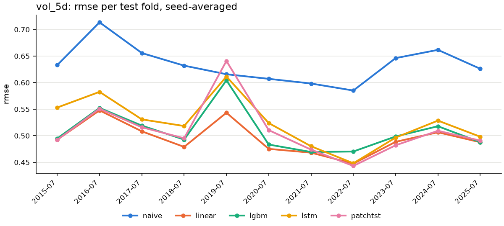
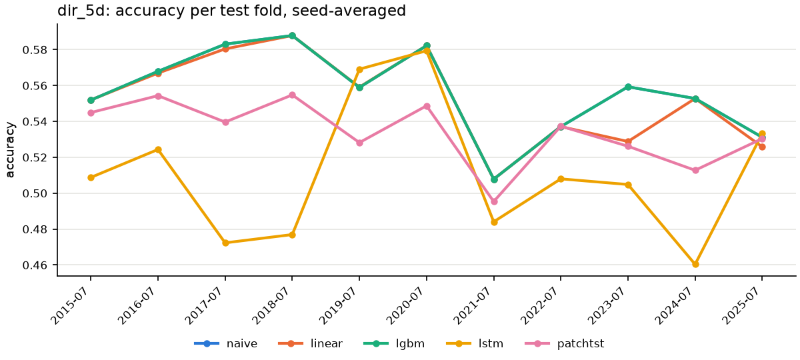
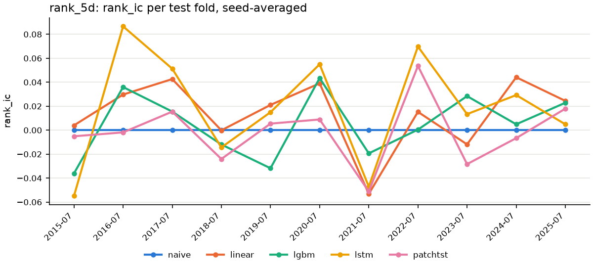
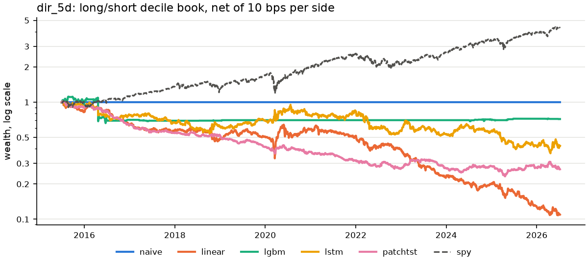
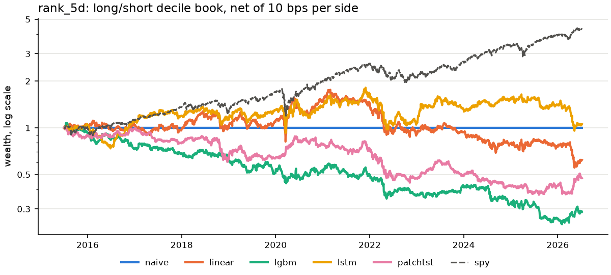

# exp02: walk-forward results

Generated 2026-10-23T21:30:59+00:00 | config `be08cae43cee` | git `6d96c99524` (dirty)

Samples 2010-04-06..2026-09-30, 190787 rows x 43 features, 46 tickers. 11 folds: train 60m / val 6m / test 12m, step 12m; test blocks 2015-07-01..2026-07-01.

Metrics are mean +- std across test folds (seed-averaged per fold first); multi-seed models also show the std across seeds of the all-fold mean. `*_tstat` columns are HAC t-stats of the mean daily IC over the pooled test dates, averaged over seeds. DM = Diebold-Mariano statistic on the pooled per-date loss differential (negative = the row's model has lower loss than the baseline), HAC lag 4; for multi-seed models: mean over seeds, [min, max], and seeds significant at 5%. `sig` counts (seed, fold) pairs with that sign and p < 0.05 out of seeds x folds. Losses: squared error on log vol / rank, Brier for direction. `linear` is ridge for vol/rank and logistic for direction.

Sequence models: lookback 64 bars, batch 512, Adam lr 0.001, early stopping on val loss (patience 3, max 20 epochs), seeds [0, 1, 2], device `auto`. LSTM: 2 layers x 64 hidden, dropout 0.2. PatchTST: patch 8 / stride 4, 2 layers, d_model 64, 4 heads, dropout 0.3, channel-independent.

## vol_5d (regression)

| model | rmse | mae | qlike | DM vs naive | sig | DM vs lgbm | sig |
|---|---|---|---|---|---|---|---|
| naive | 0.6340 +- 0.0353 | 0.4954 +- 0.0290 | 1.4434 +- 0.2498 | - | - | +20.23 (p=0.000) | 10/11 |
| linear | 0.4950 +- 0.0303 | 0.3838 +- 0.0249 | 0.7346 +- 0.1408 | -31.73 (p=0.000) | 11/11 | -3.71 (p=0.000) | 4/11 |
| lgbm | 0.5083 +- 0.0399 | 0.3934 +- 0.0308 | 0.7735 +- 0.3008 | -20.23 (p=0.000) | 10/11 | - | - |
| lstm (3 seeds) | 0.5247 +- 0.0459 (seed sd 0.0051) | 0.4093 +- 0.0371 (seed sd 0.0042) | 0.8775 +- 0.2695 (seed sd 0.0443) | -17.01 [-17.58, -16.17] 3/3 seeds | 30/33 | +5.03 [+3.97, +6.45] 3/3 seeds | 14/33 |
| patchtst (3 seeds) | 0.5095 +- 0.0513 (seed sd 0.0036) | 0.3952 +- 0.0405 (seed sd 0.0028) | 0.8537 +- 0.3677 (seed sd 0.0426) | -18.32 [-20.37, -16.92] 3/3 seeds | 30/33 | +0.69 [-0.65, +2.05] 1/3 seeds | 4/33 |

Per-fold `rmse` (seed-averaged):

| fold | test block | naive | linear | lgbm | lstm | patchtst |
|---|---|---|---|---|---|---|
| 0 | 2015-07-01..2016-07-01 | 0.6330 | 0.4925 | 0.4949 | 0.5531 | 0.4923 |
| 1 | 2016-07-01..2017-07-01 | 0.7135 | 0.5478 | 0.5524 | 0.5826 | 0.5510 |
| 2 | 2017-07-01..2018-07-01 | 0.6557 | 0.5083 | 0.5191 | 0.5308 | 0.5160 |
| 3 | 2018-07-01..2019-07-01 | 0.6320 | 0.4790 | 0.4927 | 0.5183 | 0.4952 |
| 4 | 2019-07-01..2020-07-01 | 0.6158 | 0.5433 | 0.6044 | 0.6115 | 0.6408 |
| 5 | 2020-07-01..2021-07-01 | 0.6071 | 0.4753 | 0.4834 | 0.5239 | 0.5106 |
| 6 | 2021-07-01..2022-07-01 | 0.5983 | 0.4682 | 0.4694 | 0.4802 | 0.4739 |
| 7 | 2022-07-01..2023-07-01 | 0.5851 | 0.4475 | 0.4703 | 0.4482 | 0.4432 |
| 8 | 2023-07-01..2024-07-01 | 0.6461 | 0.4885 | 0.4986 | 0.4965 | 0.4820 |
| 9 | 2024-07-01..2025-07-01 | 0.6617 | 0.5066 | 0.5179 | 0.5285 | 0.5093 |
| 10 | 2025-07-01..2026-07-01 | 0.6261 | 0.4878 | 0.4879 | 0.4982 | 0.4908 |
| pooled | all | 0.6349 | 0.4958 | 0.5098 | 0.5267 | 0.5120 |

## dir_5d (classification)

| model | accuracy | balanced_accuracy | auc | DM vs naive | sig | DM vs lgbm | sig |
|---|---|---|---|---|---|---|---|
| naive | 0.5564 +- 0.0243 | 0.5000 +- 0.0000 | 0.5000 +- 0.0000 | - | - | -1.41 (p=0.157) | 0/11 |
| linear | 0.5528 +- 0.0258 | 0.5025 +- 0.0075 | 0.5092 +- 0.0291 | +1.49 (p=0.137) | 0/11 | +0.78 (p=0.438) | 0/11 |
| lgbm | 0.5564 +- 0.0243 | 0.5000 +- 0.0000 | 0.5073 +- 0.0164 | +1.41 (p=0.157) | 0/11 | - | - |
| lstm (3 seeds) | 0.5110 +- 0.0384 (seed sd 0.0046) | 0.5003 +- 0.0239 (seed sd 0.0050) | 0.5073 +- 0.0289 (seed sd 0.0037) | +9.63 [+8.73, +10.11] 3/3 seeds | 25/33 | +9.77 [+8.88, +10.24] 3/3 seeds | 25/33 |
| patchtst (3 seeds) | 0.5339 +- 0.0181 (seed sd 0.0065) | 0.4965 +- 0.0098 (seed sd 0.0033) | 0.4883 +- 0.0250 (seed sd 0.0070) | +5.66 [+4.39, +6.66] 3/3 seeds | 16/33 | +5.42 [+4.08, +6.38] 3/3 seeds | 16/33 |

Per-fold `accuracy` (seed-averaged):

| fold | test block | naive | linear | lgbm | lstm | patchtst |
|---|---|---|---|---|---|---|
| 0 | 2015-07-01..2016-07-01 | 0.5519 | 0.5520 | 0.5519 | 0.5088 | 0.5449 |
| 1 | 2016-07-01..2017-07-01 | 0.5679 | 0.5669 | 0.5679 | 0.5244 | 0.5543 |
| 2 | 2017-07-01..2018-07-01 | 0.5831 | 0.5804 | 0.5831 | 0.4723 | 0.5396 |
| 3 | 2018-07-01..2019-07-01 | 0.5879 | 0.5879 | 0.5879 | 0.4769 | 0.5548 |
| 4 | 2019-07-01..2020-07-01 | 0.5589 | 0.5591 | 0.5589 | 0.5691 | 0.5282 |
| 5 | 2020-07-01..2021-07-01 | 0.5822 | 0.5822 | 0.5822 | 0.5794 | 0.5487 |
| 6 | 2021-07-01..2022-07-01 | 0.5078 | 0.5078 | 0.5078 | 0.4841 | 0.4953 |
| 7 | 2022-07-01..2023-07-01 | 0.5371 | 0.5371 | 0.5371 | 0.5080 | 0.5373 |
| 8 | 2023-07-01..2024-07-01 | 0.5593 | 0.5288 | 0.5593 | 0.5048 | 0.5262 |
| 9 | 2024-07-01..2025-07-01 | 0.5528 | 0.5528 | 0.5528 | 0.4603 | 0.5128 |
| 10 | 2025-07-01..2026-07-01 | 0.5312 | 0.5258 | 0.5312 | 0.5332 | 0.5304 |
| pooled | all | 0.5562 | 0.5526 | 0.5562 | 0.5111 | 0.5337 |

## rank_5d (regression)

| model | ic | rank_ic | ic_tstat | rank_ic_tstat | DM vs naive | sig | DM vs lgbm | sig |
|---|---|---|---|---|---|---|---|---|
| naive | 0.0000 +- 0.0000 | 0.0000 +- 0.0000 | 0.00 | 0.00 | - | - | -2.13 (p=0.033) | 2/11 |
| linear | 0.0117 +- 0.0263 | 0.0141 +- 0.0287 | 1.37 | 1.64 | +0.38 (p=0.707) | 0/11 | -1.52 (p=0.127) | 0/11 |
| lgbm | 0.0027 +- 0.0240 | 0.0048 +- 0.0271 | 0.40 | 0.73 | +2.13 (p=0.033) | 2/11 | - | - |
| lstm (3 seeds) | 0.0195 +- 0.0418 (seed sd 0.0033) | 0.0190 +- 0.0456 (seed sd 0.0050) | 2.17 | 2.12 | +4.88 [+4.34, +5.79] 3/3 seeds | 14/33 | +4.46 [+3.92, +5.41] 3/3 seeds | 12/33 |
| patchtst (3 seeds) | 0.0017 +- 0.0281 (seed sd 0.0143) | -0.0014 +- 0.0275 (seed sd 0.0131) | 0.23 | -0.16 | +2.47 [+1.40, +3.08] 2/3 seeds | 7/33 | +0.65 [-0.53, +1.48] 0/3 seeds | 6/33 |

Per-fold `rank_ic` (seed-averaged):

| fold | test block | naive | linear | lgbm | lstm | patchtst |
|---|---|---|---|---|---|---|
| 0 | 2015-07-01..2016-07-01 | 0.0000 | 0.0040 | -0.0361 | -0.0550 | -0.0051 |
| 1 | 2016-07-01..2017-07-01 | 0.0000 | 0.0297 | 0.0360 | 0.0866 | -0.0019 |
| 2 | 2017-07-01..2018-07-01 | 0.0000 | 0.0426 | 0.0155 | 0.0513 | 0.0155 |
| 3 | 2018-07-01..2019-07-01 | 0.0000 | -0.0001 | -0.0120 | -0.0144 | -0.0241 |
| 4 | 2019-07-01..2020-07-01 | 0.0000 | 0.0211 | -0.0318 | 0.0150 | 0.0055 |
| 5 | 2020-07-01..2021-07-01 | 0.0000 | 0.0390 | 0.0435 | 0.0549 | 0.0089 |
| 6 | 2021-07-01..2022-07-01 | 0.0000 | -0.0532 | -0.0194 | -0.0472 | -0.0511 |
| 7 | 2022-07-01..2023-07-01 | 0.0000 | 0.0153 | 0.0004 | 0.0698 | 0.0536 |
| 8 | 2023-07-01..2024-07-01 | 0.0000 | -0.0119 | 0.0284 | 0.0134 | -0.0283 |
| 9 | 2024-07-01..2025-07-01 | 0.0000 | 0.0441 | 0.0049 | 0.0293 | -0.0067 |
| 10 | 2025-07-01..2026-07-01 | 0.0000 | 0.0244 | 0.0229 | 0.0049 | 0.0179 |
| pooled | all | 0.0000 | 0.0141 | 0.0047 | 0.0189 | -0.0014 |

## Backtest: long/short decile book, 5-day holding, 10 bps per side

Each test date forms an equal-weight book long the top decile and short the bottom decile of that day's predictions (predicted probability for direction, predicted rank for rank), 1 long / 1 short per unit of capital. A book is held for 5 daily returns with capital split across the 5 live books, weights rebalanced daily to target, and 10 bps charged per unit of notional traded. A constant prediction takes no positions. Returns are raw (no risk-free adjustment) and annualised geometrically, Sharpe is on daily returns x sqrt(252), turnover is notional traded per year per unit of capital, and `HAC t` tests mean daily net return = 0 (Newey-West, lag 4). `spy` is buy-and-hold SPY over the same days with no costs. Multi-seed models: mean +- std across seeds; `-` marks a statistic undefined because the strategy never trades.

### dir_5d

| model | ann. return (net) | Sharpe (net) | max DD (net) | HAC t (net) | ann. return (gross) | Sharpe (gross) | turnover / yr |
|---|---|---|---|---|---|---|---|
| naive | +0.0% | - | 0.0% | +0.00 | +0.0% | - | 0.0 |
| linear | -18.2% | -0.84 | -89.4% | -2.71 | -5.8% | -0.18 | 141.4 |
| lgbm | -3.0% | -0.14 | -40.7% | -0.59 | -2.3% | -0.09 | 6.5 |
| lstm (3 seeds) | -8.0% +- 2.7% | -0.24 +- 0.12 | -68.3% +- 7.5% | -0.82 +- 0.41 | +2.7% +- 3.0% | +0.23 +- 0.13 | 109.9 +- 3.6 |
| patchtst (3 seeds) | -12.0% +- 3.2% | -0.69 +- 0.32 | -81.1% +- 4.4% | -2.32 +- 1.09 | +2.0% +- 4.1% | +0.18 +- 0.25 | 147.2 +- 7.7 |
| spy | +14.2% | +0.83 | -33.7% | +3.02 | +14.2% | +0.83 | 0.0 |

### rank_5d

| model | ann. return (net) | Sharpe (net) | max DD (net) | HAC t (net) | ann. return (gross) | Sharpe (gross) | turnover / yr |
|---|---|---|---|---|---|---|---|
| naive | +0.0% | - | 0.0% | +0.00 | +0.0% | - | 0.0 |
| linear | -4.2% | -0.07 | -68.5% | -0.22 | +8.5% | +0.46 | 124.8 |
| lgbm | -10.7% | -0.50 | -77.7% | -1.72 | +1.9% | +0.19 | 131.9 |
| lstm (3 seeds) | -0.1% +- 5.4% | +0.11 +- 0.23 | -54.5% +- 16.0% | +0.36 +- 0.77 | +10.2% +- 6.1% | +0.51 +- 0.22 | 97.8 +- 6.2 |
| patchtst (3 seeds) | -7.1% +- 8.9% | -0.25 +- 0.45 | -69.7% +- 19.7% | -0.82 +- 1.51 | +4.5% +- 8.9% | +0.29 +- 0.39 | 117.7 +- 12.6 |
| spy | +14.2% | +0.83 | -33.7% | +3.02 | +14.2% | +0.83 | 0.0 |

